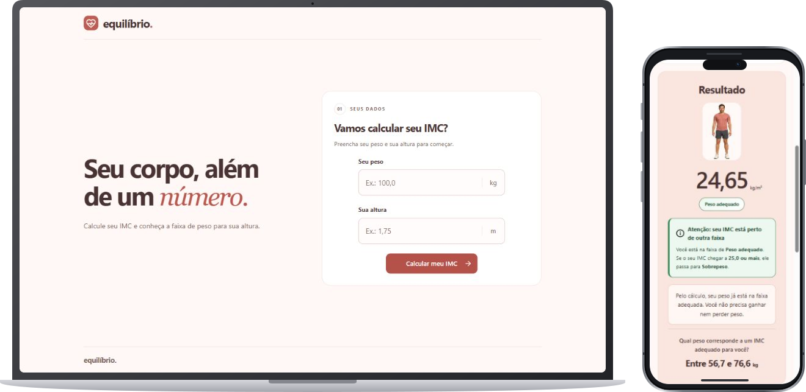

# Equilíbrio · Calculadora de IMC

Uma calculadora de Índice de Massa Corporal com interface simples e responsiva. O projeto ajuda adultos a entender a relação entre peso e altura, visualizar sua classificação e conhecer a faixa de peso de referência pelo IMC.



## Links

- [Acessar o projeto na Vercel](https://projeto-calculadora-eelmfe35p-netomendes21s-projects.vercel.app).
- [Ver o código no GitHub](https://github.com/netoMendes21/Calculadora-IMC).

## Objetivo

Transformar um cálculo em uma informação fácil de entender, com campos intuitivos, resultado em destaque e orientações em linguagem simples. Também é um projeto de estudo de React, TypeScript e interfaces responsivas, desenvolvido a partir de um mini projeto da Codante.

## Funcionalidades

- Peso e altura com vírgula automática, unidades visíveis e validação das entradas.
- Cálculo do IMC com duas casas decimais e classificação pelo valor sem arredondamento.
- Tabela de classificação para adultos, com destaque animado na categoria atual.
- Alertas de baixo peso e de proximidade entre as faixas de classificação.
- Faixa de peso por altura e estimativa de quantos quilos ganhar ou perder para chegar à faixa de referência.
- Layout adaptado para computador e celular, com rótulos claros e navegação por teclado.

O IMC é uma referência geral: não avalia sozinho a saúde ou a composição corporal e não substitui uma avaliação profissional.

## Tecnologias

| Tecnologia | Uso |
| --- | --- |
| React 19 e TypeScript | Componentes, estado e regras de cálculo |
| Vite 7 | Ambiente de desenvolvimento e build |
| Tailwind CSS 4 e CSS | Estilos e layout responsivo |
| Lucide | Ícones SVG locais |
| ESLint e Node.js Test Runner | Análise do código e testes automatizados |

## Como executar

Requer **Node.js 22.18+ ou 24+** e npm.

```sh
npm ci
npm run dev
```

Abra o endereço informado pelo Vite no terminal.

### Verificações e build

```sh
npm test
npm run lint
npm run build
```

Para visualizar o build localmente, execute `npm run preview`.

## Referências e créditos

- [OMS — referência de IMC](https://www.who.int/data/nutrition/nlis/info/malnutrition-in-women).
- [CDC — categorias de IMC para adultos](https://www.cdc.gov/bmi/adult-calculator/bmi-categories.html).
- [Codante — mini projeto original](https://codante.io/mini-projetos/calculadora-de-imc-com-react).
- Ícones [Lucide](https://lucide.dev), com [licença incluída no projeto](src/assets/icons/LICENSE).
