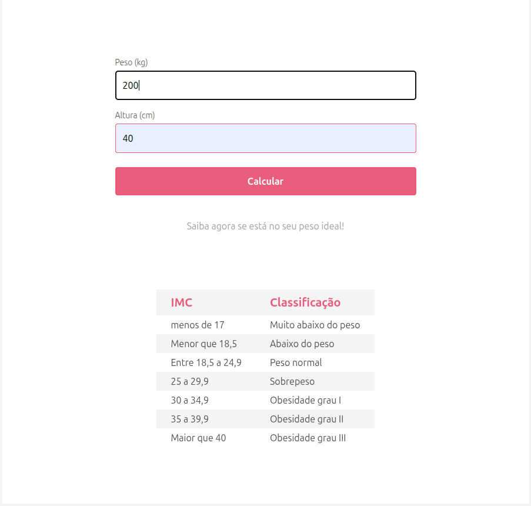
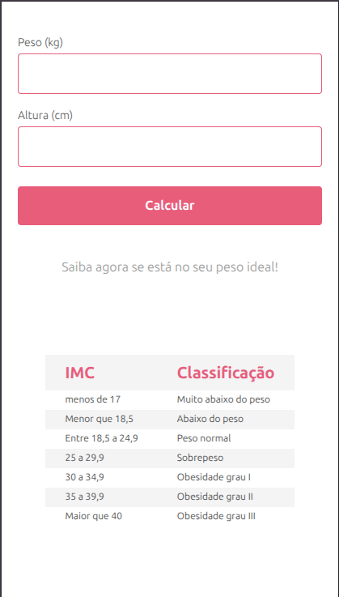
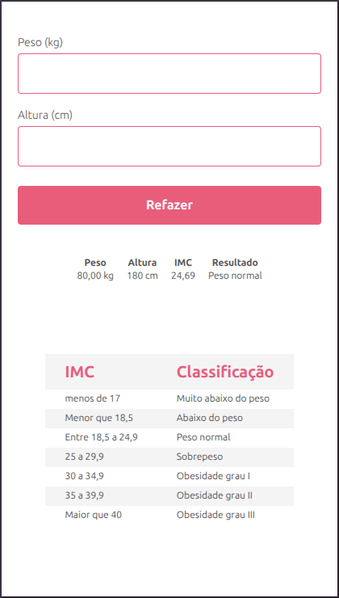
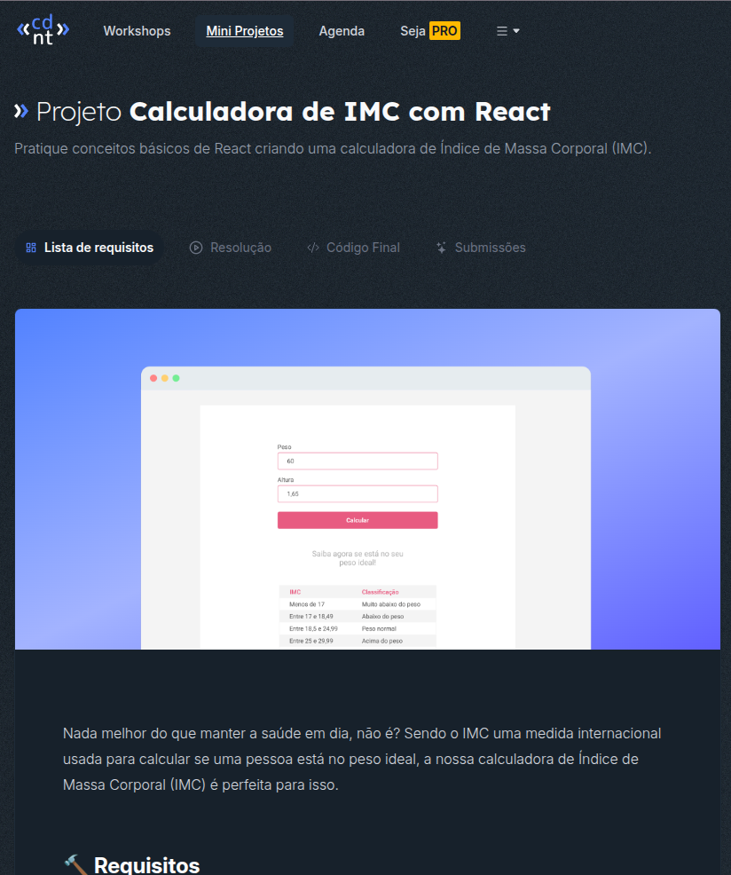

# Calculadora para calcular o Índice de Massa Corporal(IMC)

## Desenvolvimento e verificação

Requer Node.js 22.18+ ou 24+ (os testes executam TypeScript nativamente).

```sh
npm ci
npm run dev
npm test
npm run lint
npm run build
```

O projeto usa React 19, TypeScript, Vite e Tailwind. Os campos recebem peso em
quilogramas e altura em metros, com vírgula automática durante a digitação:
`755 → 75,5 kg` (uma casa decimal) e `175 → 1,75 m` (duas casas decimais).
Para informar 75 kg, digite `750`; para 2 m, digite `200`. Os exemplos ficam
visíveis abaixo de cada campo. A máscara preserva a posição de edição e permite
apagar o campo por completo. Valores formatados com ponto ou vírgula também
podem ser colados, respeitando as casas do campo. Separadores de milhar,
unidades no campo e colagens ambíguas são rejeitados com orientação.
Os limites de entrada originais foram preservados: 2–500 kg e 0,50–2,50 m.

As faixas são definidas em `src/lib/IMC.ts` e compartilhadas pelo resultado e pela
tabela: abaixo de 18,5; de 18,5 a menos de 25; de 25 a menos de 30; de 30 a menos
de 35; de 35 a menos de 40; e a partir de 40. A classificação usa o valor sem
arredondamento. O resultado exibe duas casas e a diferença de peso, uma casa.

A faixa de peso usa `[18,5 × altura², 25 × altura²)`. O limite superior é exclusivo:
atingir exatamente IMC 25 ainda corresponde a sobrepeso. Os valores exibidos são
aproximados, e a interface explica esse limite. Não há recomendação de alteração
de peso quando o resultado está dentro da faixa de referência.

O resultado avisa quando o IMC está a até 0,5 ponto de qualquer limite de
classificação, nos dois sentidos, usando o valor sem arredondamento. Esse é um
critério da interface para destacar proximidade, não um novo limite clínico.
O aviso informa a faixa atual, a faixa vizinha e o valor que separa as duas.

O baixo peso recebe alerta próprio em todos os resultados abaixo de 18,5.
O destaque é vermelho claro de 17 a menos de 18,5, vermelho de 16 a menos de 17
e vermelho escuro abaixo de 16, seguindo os cortes de magreza descritos pela OMS.
Peso adequado usa verde; sobrepeso usa âmbar; obesidade usa vermelhos progressivos.
A pulsação inclui um halo visível e permanece ativa enquanto houver uma faixa
selecionada. O último resultado é mantido durante a edição dos campos e só muda
ao calcular novamente ou usar Refazer.

Referências: [OMS](https://www.who.int/data/nutrition/nlis/info/malnutrition-in-women)
e [CDC — classificação e graus de obesidade](https://www.cdc.gov/bmi/adult-calculator/bmi-categories.html).
O IMC é uma referência geral para adultos e não substitui avaliação individual.

As imagens abaixo registram a versão original do projeto.

### Inserindo o peso e altura ela te retorna em qual classificação você está.

#### Desktop

<br>

#### Mobile
<div>


</div>


## 🛠️ Tecnologias

- React
- Typescript
- TailwindCss
  <br><br>

# Mini projeto feito da plataforma Codante.


<br> <br>

## Links:
<p>Projeto: <a href="https://projeto-calculadora-eelmfe35p-netomendes21s-projects.vercel.app">Caculador-IMC</a></p>
<p>Plataforma Codante: <a href="https://codante.io/mini-projetos/calculadora-de-imc-com-react" target="_blank">Codante</a></p>
